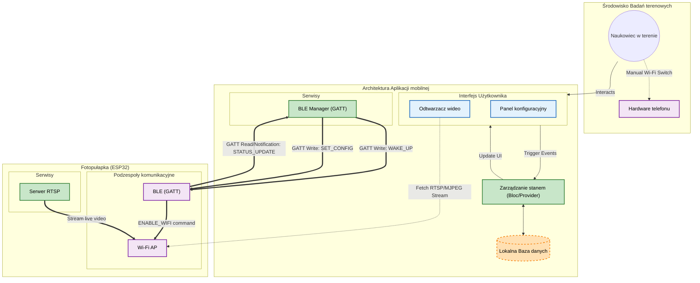
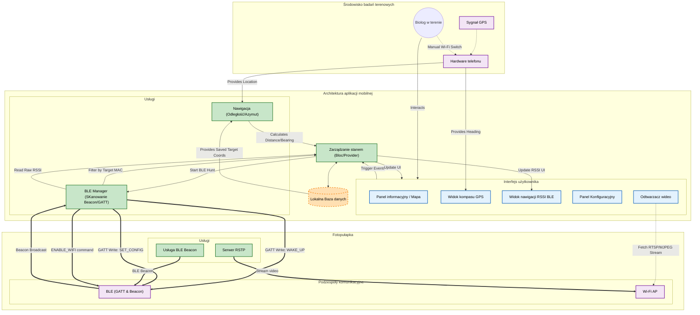

# Specyfikacja Interfejsu Użytkownika i Architektury Aplikacji: Fotopułapka AI

## 1. Docelowe Funkcje

### Funkcje podstawowe (Core features):
* **Zdalna konfiguracja:** Komendy Bluetooth (regulacja progów detekcji false positives, czułości PIR, włączenie strumieniowania wideo poprzez Wi-Fi, informacje o statusie).
* **Strumieniowanie wideo:** Podgląd na żywo z kamery poprzez Wi-Fi (opcjonalne nałożenie obszaru czułości PIR na obraz w celu łatwiejszej konfiguracji).
* **Zarządzanie statusami:** Przetwarzanie i wysyłanie podstawowych informacji o statusie urządzenia poprzez Bluetooth (poziom baterii, wolna pamięć karty SD, komunikaty o błędach).

### Dodatkowa funkcjonalność (Nice-to-haves):
* **Makro-nawigacja:** Zapisywanie lokalizacji GPS oraz nawigacja na azymut w celu odnalezienia kamery w terenie.
* **Mikro-nawigacja:** Tryb nawigacji ciepło-zimno oparty o RSSI sygnału Bluetooth (BLE Beacon) do precyzyjnej lokalizacji urządzenia w bliskim otoczeniu.

## 2. Stos Technologiczny (Tech Stack)

| Moduł | Funkcjonalność | Rekomendowane pakiety Flutter |
| :-- | :-- | :-- |
| **Dane i Stan** | Lokalne przechowywanie punktów trasy, profili kamer i logów | `hive` lub `sqflite`, `provider` lub `flutter_bloc` |
| **Makro-Nawigacja** | Współrzędne GPS, obliczanie dystansu, azymut kompasu | `geolocator`, `flutter_compass` |
| **Mikro-Nawigacja** | Skanowanie BLE, komenda wybudzenia, filtrowanie sygnału RSSI | `flutter_blue_plus`, `permission_handler` |
| **Konfiguracja (BLE)** | Operacje zapisu GATT | `flutter_blue_plus` |
| **Strumieniowanie wideo** | Strumień wideo na żywo (RTSP lub MJPEG) | `flutter_vlc_player` lub `webview_flutter` |

## 3. Kluczowe Widoki UI i Wymagania Terenowe (Field-Ready UX)

* **Panel Konfiguracyjny (Configuration Panel):** Suwaki i przełączniki do regulacji czułości PIR, progów AI oraz przycisk wybudzania (`WAKE_UP`).
* **Odtwarzacz Wideo (VLC Wrapper):** Strumień RTSP/MJPEG na żywo z opcjonalną nakładką detekcji PIR.
* **Ergonomia terenowa:** Wysoki kontrast, czytelność w pełnym słońcu oraz opcjonalny tryb nocny chroniący wzrok badacza.
---
**Opcjonalne:**
* **Pulpit i Widok Mapy (Dashboard & Map View):** Główny panel zarządzania listą fotopułapek, podgląd stanu baterii, pamięci SD oraz szybki dostęp do lokalizacji.
* **Widok Kompasu GPS (Macro-Navigation View):** Tarcza kompasu, wskaźnik azymutu w stopniach oraz aktualizowany dystans w metrach do celu.
* **Widok Poszukiwania Hot-Cold (Micro-Navigation View):** Dynamiczny wskaźnik siły sygnału BLE RSSI do precyzyjnego namierzania urządzenia w najbliższym otoczeniu.

## Szacunkowa pracochłonność (Effort Estimate)

| Moduł / Faza | Opis zakresu prac | Szacowany czas (godziny) |
| :--- | :--- | :--- |
| **1. Architektura i Baza Danych** | Konfiguracja projektu Flutter, lokalna baza danych (Hive/SQLite), ekrany główne (Dashboard). | 24–40 godz. |
| **2. Konfiguracja i Status (BLE)** | Implementacja GATT Writes dla ustawień PIR, pobieranie statusu baterii i pamięci SD. | 32–48 godz. |
| **3. Strumieniowanie Wideo (Wi-Fi)** | Ręczny przełącznik sieci, obsługa odtwarzacza VLC/RTSP, stabilizacja strumienia. | 48–72 godz. |
| **4. Mikro-Nawigacja (BLE) Opcjonalnie** | Skanowanie BLE, obsługa beaconów, filtracja sygnału RSSI (Hot-Cold UI). | 40–64 godz. |
| **5. Makro-Nawigacja (GPS) Opcjonalnie** | Integracja geolokalizacji, kompasu, obliczanie azymutu i dystansu do fotopułapki. | 32–48 godz. |
| **Całkowity szacowany czas:** | *Rekomendowane przydzielenie jeszcze co najmniej 1 osoby (roboczogodziny)* | **~216–328 roboczogodzin** |

## Diagram interakcji (Funkcje podstawowe)

## Diagram Interakcji (Pełny feature set):
